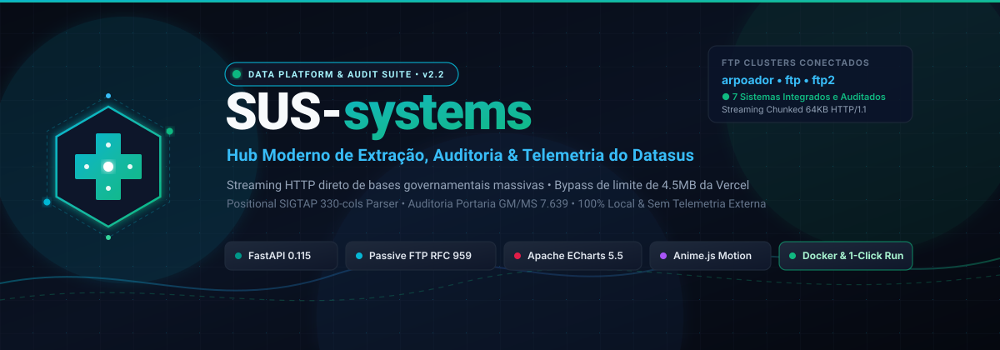
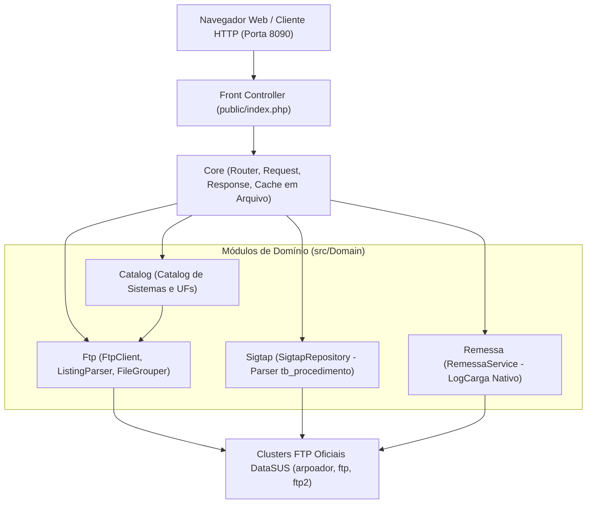

<p align="center">
  
</p>

<p align="center">
  <a href="https://www.php.net/"></a>
  
  <a href="docker-compose.yml"></a>
  <a href="LICENSE"></a>
</p>

---

## Visão Geral

O **SUS-systems 3.0** é uma plataforma moderna, leve e open-source para consultar, auditar e baixar dados públicos oficiais do DataSUS (Ministério da Saúde do Brasil).

Reescrito em **PHP 8.2+ / 8.3 sem frameworks pesados nem dependências externas**, o sistema converte protocolos legados (FTP passivo RFC 959 com listagens IIS e Unix) em fluxos HTTP/HTTPS modernos e estruturados. Permite streaming em tempo real de grandes volumes de dados sem estourar memória, além de incluir um motor de consulta e diff posicional para a tabela unificada **SIGTAP** e consulta nativa de remessas mensais do SIA diretamente via FTP LogCarga (sem depender de proxies externos).

A aplicação roda perfeitamente em:
- **Containers Docker** (imagem oficial Apache + PHP 8.3);
- **Hospedagem compartilhada** (cPanel / Apache com `.htaccess` e DocumentRoot em `public/`);
- **Servidor embutido do PHP** (`php -S`) para desenvolvimento local rápido.

---

## Arquitetura



### Características Centrais
1. **Zero Dependências Externas**: Utiliza apenas extensões nativas do PHP (`ftp`, `zip`, `curl`, `mbstring`). Autoload PSR-4 próprio em `src/bootstrap.php`.
2. **Streaming sob Demanda**: Transferência de arquivos em chunks (64 KB) através de `StreamResponse`, mantendo o consumo de memória baixo e estável.
3. **Cache de Alta Performance em Disco**: Armazenamento local com TTL ajustável para listagens e índices SIGTAP, minimizando requisições redundantes aos servidores do DataSUS.
4. **Remessas SIA Nativas**: Consulta de remessas e logs de processamento mensal (LogCarga`<ano>`) conectando-se diretamente via FTP ao cluster oficial do DataSUS, eliminando a dependência do proxy legado downloadsus.
5. **Proteção Anti-SSRF**: Validação estrita de hosts autorizados (`allowed_hosts`), bloqueando redirecionamentos indevidos.

---

## Como Rodar

### Opção 1: Docker Compose (Recomendado)

Suba o container pré-configurado:

```bash
docker compose up -d --build
```

Acesse no navegador:
👉 `http://localhost:8090`

Para rodar os testes dentro do container:
```bash
docker exec sus-systems-app php tests/run.php
```

---

### Opção 2: Servidor Embutido do PHP (Local)

Requer PHP 8.2 ou superior instalado com extensões `ftp`, `zip`, `curl` e `mbstring`:

```bash
php -S localhost:8090 -t public public/index.php
```

---

### Opção 3: Hospedagem Compartilhada (Apache / cPanel)

1. Faça o upload dos arquivos para a sua hospedagem.
2. Aponte o **DocumentRoot** do domínio/subdomínio para a pasta `public/`.
3. Certifique-se de que o Apache esteja com o módulo `mod_rewrite` ativado (o arquivo `public/.htaccess` já direciona as requisições para o `index.php`).
4. Garanta permissão de escrita para o servidor web na pasta `storage/cache/`.

---

### Opção 4: Scripts de Inicialização Rápida

- **Windows**: Dê duplo clique em `run_windows.bat` (sobe via Docker Compose ou fallback com `php -S`).
- **Linux / macOS**: Execute `./run_linux.sh`.

---

## Variáveis de Ambiente (`config/app.php`)

As configurações podem ser definidas via variáveis de ambiente no container ou no arquivo `.env`:

| Variável | Padrão | Descrição |
| :--- | :--- | :--- |
| `APP_DEBUG` | `false` | Exibe mensagens detalhadas de exceções em caso de erro |
| `CACHE_DIR` | `SUS_ROOT/storage/cache` | Diretório em disco para os arquivos serializados de cache |
| `FTP_CACHE_TTL` | `600` | Tempo de vida (TTL) do cache de listagens FTP (em segundos, padrão: 10 min) |
| `SIGTAP_CACHE_TTL` | `86400` | TTL para parsing da competência SIGTAP (em segundos, padrão: 24 horas) |
| `FTP_TIMEOUT` | `8` | Timeout em segundos para conexão com servidores FTP do DataSUS |
| `FTP_HTTPS_BRIDGE` | `""` | URL opcional de ponte HTTPS caso a porta 21 esteja bloqueada na rede |

---

## Tabela de Endpoints da API

A API mantém total compatibilidade com o legado, respondendo tanto com prefixo `/api/*` quanto diretamente na raiz:

| Método | Endpoint | Descrição |
| :--- | :--- | :--- |
| `GET` | `/` | Interface gráfica web do sistema (Server-Side Rendering) |
| `GET` | `/api/health` | Diagnóstico de integridade do app e conectividade com clusters FTP |
| `GET` | `/api/catalog` | Áreas, sistemas e diretórios públicos mapeados |
| `GET` | `/api/subgroup-data` | Metadados e arquivos de um subgrupo (`group_id`, `sub_name`) |
| `GET` | `/api/ftp-list` | Listagem processada de arquivos com agrupamento de versões e UFs |
| `GET` | `/api/ftp-download` | Streaming HTTP direto do arquivo selecionado (`url`, `filename`) |
| `GET` | `/api/remessa` | Consulta nativa FTP de arquivos de remessa SIA (LogCarga por `ibge`, `ano`) |
| `GET` | `/api/sigtap/competencias`| Lista de competências disponíveis para download no SIGTAP |
| `GET` | `/api/sigtap/explore` | Pesquisa de procedimentos por código, nome, grupo e financiamento |
| `GET` | `/api/sigtap/diff` | Comparativo posicional de procedimentos entre duas competências |

---

## Estrutura de Pastas

```
SUS-systems/
├── assets/                 # Imagens institucionais (banner, ilustrações)
├── config/                 # Configurações gerais, catálogo e mapeamento de rotas
│   ├── app.php             # Variáveis de ambiente e parâmetros do sistema
│   ├── catalog.php         # Definição dos sistemas, regras de extração e UFs
│   └── routes.php          # Registro das rotas web e API
├── docker/                 # Arquivos de infraestrutura de container
│   └── Dockerfile          # Imagem php:8.3-apache com extensões compiladas
├── docs/                   # Documentação técnica e guias
│   ├── ARCHITECTURE.md     # Contrato de arquitetura e interfaces
│   ├── DEPLOY.md           # Guia de implantação em produção
│   ├── QA.md               # Relatórios e roteiros de garantia de qualidade
│   └── TESTING.md          # Guia do runner e execução de testes
├── legacy-python/          # Backend Python legado (apenas referência, somente leitura)
├── public/                 # DocumentRoot público
│   ├── assets/             # CSS, JavaScript e ícones
│   ├── .htaccess           # Regras de reescrita Apache para o Front Controller
│   └── index.php           # Front Controller da aplicação
├── src/                    # Código-fonte PHP 8.2+ (namespace SusSystems)
│   ├── bootstrap.php       # Autoload PSR-4 nativo e inicialização do ambiente
│   ├── helpers.php         # Funções auxiliares (escape HTML, asset versioning)
│   ├── Core/               # Motor HTTP (Router, Request, Response, Cache, Config)
│   ├── Domain/             # Regras de negócio (Ftp, Sigtap, Catalog, Remessa)
│   └── Http/Controllers/  # Controllers web e REST
├── storage/                # Armazenamento volátil (cache em disco)
│   └── cache/
├── templates/              # Templates PHP limpos (layout, páginas e partials)
├── tests/                  # Suíte de testes unitários e de integração
│   ├── helpers.php         # Asserções globais (assert_same, assert_throws, etc.)
│   ├── run.php             # Runner CLI sem dependências externas
│   └── *Test.php           # Casos de teste
├── docker-compose.yml      # Orquestração do container local
├── run_linux.sh            # Script de inicialização para Linux / macOS
└── run_windows.bat         # Script de inicialização para Windows
```

---

## Conformidade, LAI e LGPD

O **SUS-systems** consome e indexa unicamente informações e bases de dados abertas do DataSUS, em conformidade com:
- **Lei de Acesso à Informação (Lei nº 12.527/2011)**: Amplo acesso aos dados públicos de saúde;
- **Lei Geral de Proteção de Dados (Lei nº 13.709/2018 - LGPD)**: Tratamento exclusivo de dados não identificáveis e estatísticas públicas anonimizadas.

> **Nota:** Trata-se de uma iniciativa de código aberto independente, sem qualquer vínculo institucional ou governamental com o Ministério da Saúde.

---

## Licença

Distribuído sob a licença [MIT](LICENSE).
