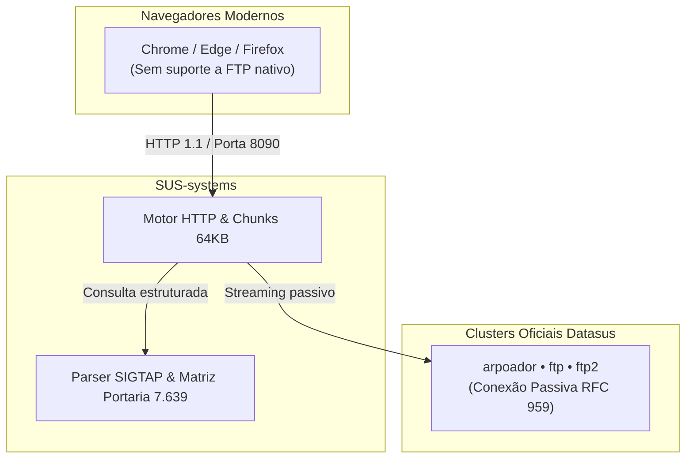

<p align="center">
  
</p>

<p align="center">
  <a href="https://sus-systems.vercel.app"></a>
  <a href="https://www.python.org/downloads/"></a>
  <a href="https://fastapi.tiangolo.com/"></a>
  <a href="LICENSE"></a>
</p>

---

## Visão Geral

O **SUS-systems** é uma aplicação open-source para consultar, baixar e auditar dados públicos do Datasus (Ministério da Saúde). 

O projeto elimina a necessidade de clientes FTP legados e converte estruturas de arquivos antigas em fluxos HTTP diretos, com suporte a streaming de arquivos grandes, parser posicional da tabela SIGTAP e matriz de conformidade para a Portaria GM/MS nº 7.639/2025.

🌐 **Acesso online:** [sus-systems.vercel.app](https://sus-systems.vercel.app)  
💻 **Execução local:** recomendada para extração massiva de bases completas (sem limites de payload).

---

## Arquitetura



---

## O que a ferramenta entrega

- **Download sem cliente FTP:** Navegadores modernos removeram o suporte ao protocolo `ftp://`. O SUS-systems atua como ponte transparente em HTTP.
- **Leitor SIGTAP integrado:** Lê os registros posicionais do arquivo `tb_procedimento.txt` sem depender de ferramentas legadas de 32 bits.
- **Auditoria da Portaria 7.639/2025:** Painel de conformidade e elegibilidade de procedimentos para equipes de Atenção Primária (eSF, eAP e eMulti).
- **Interface responsiva:** Tema escuro nativo, navegação por abas com transições fluidas e busca instantânea de arquivos e tabelas.
- **Autonomia local:** Roda diretamente no Windows, Linux ou via container Docker sem exigência de banco de dados externo.

---

## Sistemas Integrados

| Sistema | Sigla / Área | Conteúdo Principal |
| :--- | :--- | :--- |
| **SIA** | Ambulatorial | Produção ambulatorial, boletins BPA e APAC por UF e competência |
| **SIGTAP** | Tabela Unificada | Procedimentos, compatibilidades, medicamentos e valores SUS |
| **CNES** | Estabelecimentos | Dados cadastrais de unidades de saúde, profissionais e leitos |
| **e-SUS APS** | Atenção Primária | Pacotes de instalação e migração do Prontuário Eletrônico (PEC) |
| **PNI & SISVAN** | Imunização / Nutrição | Boletins vacinais históricos e acompanhamento nutricional |
| **TabWin & DBC** | Tabuladores | Utilitários de tabulação, arquivos de definição (DEF) e conversão (CNV) |
| **Portaria 7.639** | Matriz Financeira APS | Validação de elegibilidade e conformidade para cofinanciamento |

---

## Como Rodar Localmente

### Opção 1: Windows (1 Clique)

Dê um duplo clique no arquivo [`run_windows.bat`](run_windows.bat) ou execute via terminal:

```cmd
run_windows.bat
```

> O script cria automaticamente o ambiente virtual `.venv`, instala as dependências e abre o navegador em `http://127.0.0.1:8090`.

---

### Opção 2: Docker

```bash
docker compose up -d --build
```

Acesse em: `http://localhost:8090`

---

### Opção 3: Manual (Linux / macOS / Windows)

```bash
# 1. Clonar o projeto
git clone https://github.com/weesrnp/SUS-systems.git
cd SUS-systems

# 2. Configurar ambiente
python3 -m venv .venv
source .venv/bin/activate  # No Windows: .venv\Scripts\activate
pip install -r requirements.txt

# 3. Iniciar servidor
python -m uvicorn app.main:app --host 127.0.0.1 --port 8090
```

---

## Endpoints da API

| Rota | Descrição |
| :--- | :--- |
| `GET /api/health` | Status de integridade e conectividade dos clusters FTP |
| `GET /api/catalog` | Lista de sistemas e diretórios públicos disponíveis |
| `GET /api/browse?system_id=...` | Listagem em tempo real de arquivos e subpastas no Datasus |
| `GET /api/download?system_id=...&file_path=...` | Streaming HTTP direto do arquivo selecionado |
| `GET /api/sigtap/explore?comp=...&q=...` | Consulta de procedimentos na tabela unificada |
| `GET /api/municipal/matrix` | Matriz de conformidade da Portaria GM/MS 7.639/2025 |

Documentação Swagger interativa: `http://127.0.0.1:8090/docs`

---

## Conformidade e Dados Públicos

Este projeto consome exclusivamente dados públicos disponibilizados pelo Datasus em conformidade com a Lei de Acesso à Informação (Lei nº 12.527/2011) e a LGPD (Lei nº 13.709/2018). Trata-se de uma iniciativa de código aberto, sem vínculo governamental oficial.

## Licença

Distribuído sob licença [MIT](LICENSE).
